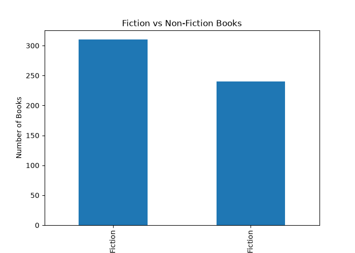
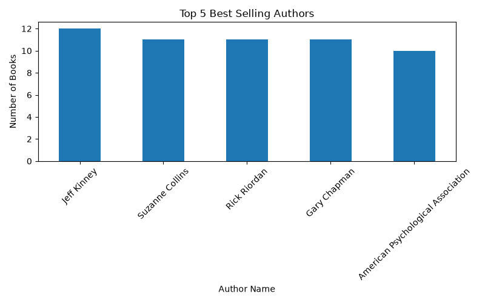
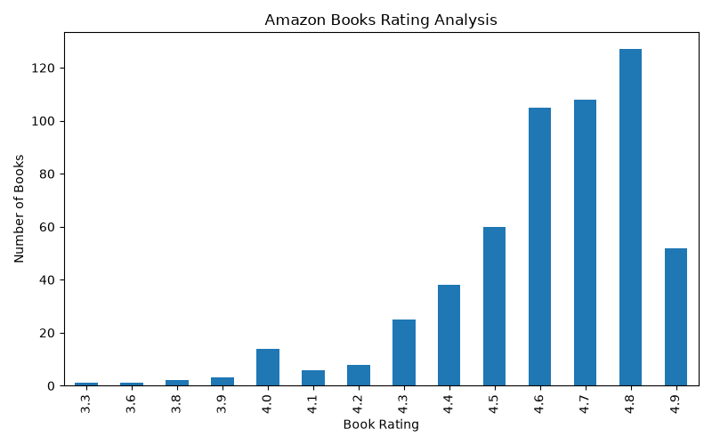
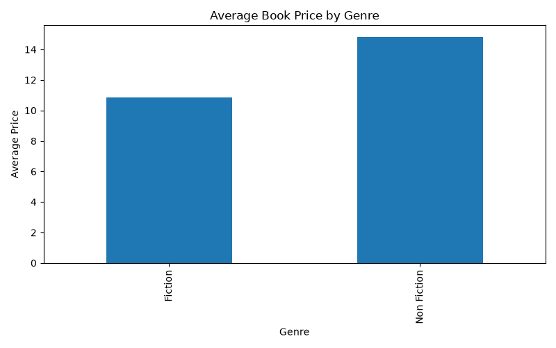
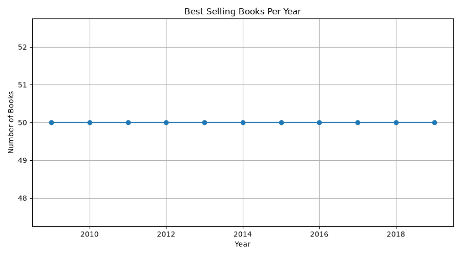

# 📚 Amazon Best-Selling Books Analysis

### Data Analysis and Visualization using Python

## 📌 Project Overview

This project explores Amazon's Top 50 Best-Selling Books
dataset from 2009 to 2019.

Using Python, I analyzed book ratings, authors, prices,
genres and yearly trends to discover useful insights
from the dataset.

## 🎯 Project Objectives

- Analyze best-selling books.
- Identify popular authors.
- Understand book rating distributions.
- Compare Fiction and Non-Fiction books.
- Analyze average book prices.
- Explore yearly book trends.

## 🛠️ Technologies Used

- Python
- Pandas
- NumPy
- Matplotlib
- VS Code

## 📊 Project Visualizations

### 1. Fiction vs Non-Fiction Books



### 2. Top 5 Authors



### 3. Book Ratings Analysis



### 4. Average Book Price



### 5. Best-Selling Books Per Year



## 📂 Project Structure

```text
Amazon-Books-Analysis/
│
├── analysis.py
├── bestsellers.csv
├── requirements.txt
├── README.md
├── report.txt
├── authors.png
├── genre.png
├── ratings.png
├── price.png
└── year.png
